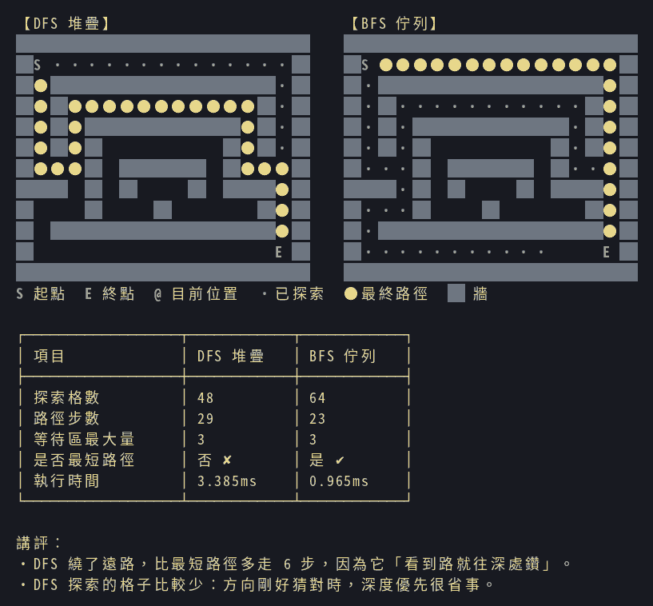
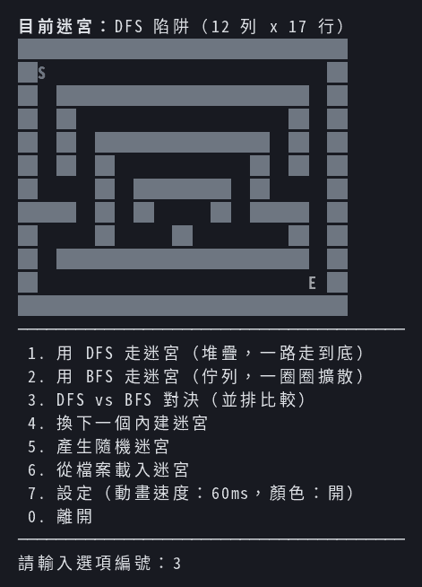
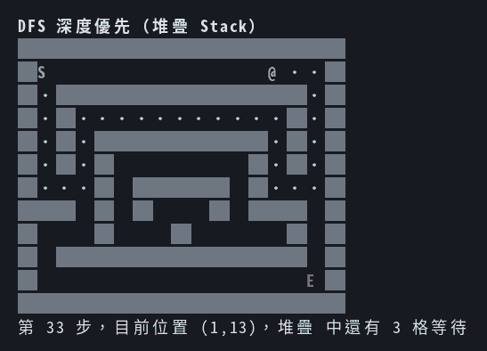

# 迷宮探險家 Maze Explorer：堆疊 DFS vs 佇列 BFS 路徑求解對決

同一座迷宮，讓「用堆疊的 DFS」和「用佇列的 BFS」各走一次，
用終端機動畫看兩者怎麼探索，最後並排比較誰走得短、誰探索得少。



## 功能

| 選項 | 功能 | 對應資料結構 |
|---|---|---|
| 1 | DFS 動畫求解：一路走到底，死路再回頭 | 堆疊 `ArrayDeque` (push/pop) |
| 2 | BFS 動畫求解：一圈一圈往外擴散 | 佇列 `LinkedList` (offer/poll) |
| 3 | DFS vs BFS 並排對決＋比較表＋自動講評 | 全部 |
| 4 | 切換 3 座內建迷宮（入門、DFS 陷阱、開闊廣場） | — |
| 5 | 隨機產生迷宮（可指定大小與亂數種子） | 堆疊（隨機回溯法挖迷宮） |
| 6 | 從文字檔載入自訂迷宮 | 清單 `List<String>` |
| 7 | 設定動畫速度、開關顏色 | — |

另外也用到：
- **集合** `HashSet<Point>`：記錄走過的格子，避免繞圈。
- **字典** `HashMap<Point, Point>`：記錄每一格是從哪一格走來，找到終點後回推完整路徑。
- **清單** `ArrayList<Point>`：保存探索順序（動畫重播用）與最終路徑。

## 執行方式

需要 **JDK 17 以上**。

**NetBeans**（課程使用環境，建議）
1. `File → Open Project…` 選擇本專案資料夾（圖示會顯示為咖啡杯專案）。
2. 按工具列綠色 ▶ `Run Project`（F6）即可執行。
3. 第一次開啟時 NetBeans 會自動產生 `nbproject/build-impl.xml`，屬正常現象。

**VS Code**（建議安裝 Extension Pack for Java）
1. `File → Open Folder…` 選擇本專案資料夾。
2. 打開 `src/maze/Main.java`，按 `Run`（或 F5，選 *Maze Explorer*）。

**IntelliJ IDEA**
1. `File → Open…` 選擇本專案資料夾。
2. 在 `src` 資料夾按右鍵 → `Mark Directory as → Sources Root`。
3. 打開 `Main.java`，按左側綠色 ▶ 執行。

**命令列**
```bash
# macOS / Linux
./run.sh
# Windows（雙擊也可以）
run.bat
```

> 小提醒：IDE 的輸出視窗不支援「清除畫面」，程式偵測到時會自動關閉動畫、直接顯示結果。
> 想看完整動畫請用系統終端機執行 `run.bat` / `run.sh`（或在選項 7 手動開啟）。
> 如果畫面出現亂碼或奇怪的 `[0m` 符號，請在選項 7 關閉顏色。

## 自訂迷宮檔格式

放在 `mazes/` 資料夾，用任何文字編輯器編寫（UTF-8）：

```
#########
#S..#...#
#.#.#.#.#
#.#...#E#
#########
```
`#` 牆、`.`（或空白）通道、`S` 起點、`E` 終點。

## 專案結構

```
MazeExplorer/
├─ src/maze/
│  ├─ Main.java      文字選單介面、動畫、比較表
│  ├─ Solver.java    DFS（堆疊）與 BFS（佇列）演算法
│  ├─ Maze.java      迷宮資料、讀檔、隨機產生（堆疊回溯法）
│  ├─ Renderer.java  終端機繪圖與 ANSI 顏色
│  └─ Point.java     座標（record，可放入 HashSet/HashMap）
├─ mazes/            自訂迷宮範例檔
├─ docs/             截圖
├─ nbproject/        NetBeans 專案設定（Open Project 直接載入）
├─ build.xml         NetBeans Ant 建置檔
├─ run.sh / run.bat  一鍵執行
└─ .vscode/          VS Code 執行設定
```

## 截圖

| 主選單 | DFS 動畫進行中 |
|---|---|
|  |  |
